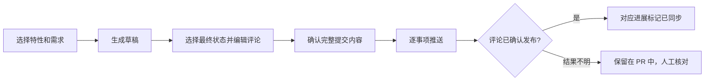

# Jira 进展管理

## 使用

1. 在个人设置填写自己的 Jira PAT，点击“验证并保存”。输入可见，保存后不回显 Token。替换失败保留原连接。
2. 打开 `/jira` 查看项目全部未归档需求，包括已完成、已取消和未关联需求。标题、编号、Feature、Phase、本地状态、Jira 状态及读取结果均可筛选。默认每页 20 条，翻页不请求 Jira。
3. 点击“刷新 Jira 状态”读取当前账号有权访问的事项。每批最多 50 项，并发最多 4 个；可以停止后续批次。失败保留已完成结果，不自动重试。
4. 点击“修改状态”，选择“操作名称 → 到达状态”，核对后点击“确认修改 Jira”。每次只执行一个转换，不根据本地进度推导状态，不连续流转。备注仅保存在本地审计中。
5. “发现未纳入需求”进入 `/jira?view=discovery`。发现范围支持 Jira 项目、类型、组件、负责人、标签和 JQL。可以录入、关联、忽略和恢复；发现范围不影响主列表。

需求详情“概况”复用相同的 Jira 状态和操作。项目经理才能读取或修改远端事项；每次操作还受本人 Jira 权限限制。没有个人 Token 时仍可查看本地需求。非经理可以查看主要关联及参考资料中的共享链接，不调用 Jira 远端接口。

## 创建 PR

`需求进展 | 发现未纳入需求 | PR` 是同级视图。`/jira/prs` 直接进入当前 PR；历史和同步记录在次级入口。

1. 勾选多个 Feature，默认包含全部 Phase 和需求，可排除个别需求。范围表按需求紧凑分页，显示本地状态、待同步数量和 Jira 关联。
2. 点击“创建 PR”直接进入草稿，按需求生成简短进展摘要，完整保留本次范围内全部未同步的人工评论。无法关联的记录保留待同步；首次使用不默认忽略历史。
3. 变更清单并列显示本地状态、Jira 当前状态和最终目标，支持 Feature / Phase 联动筛选与分页。展开一个需求编辑评论；每个需求只选择一次最终状态，系统生成实际路径和对应评论。有多条候选路径时选择整条路线，不逐步编排操作。
4. 查看完整提交内容和本人 Jira 身份，确认推送。评论先发布，状态随后修改，结果分别记录。

每个项目只有一个进行中的共享 PR。草稿自动保存；多人编辑冲突时保留输入并显示版本对比。“更新草稿”先预览增量，只追加新进展、不覆盖原文；开始执行后不再收集新记录。“添加需求与评论”可加入没有新进展的需求；“添加评论”增加独立评论，不修改状态。

PR 加载时保留导航、筛选栏和表格框架，不先显示空历史。待确认目标、待检查评论和推送异常直接标在需求行，可用“待处理”筛选；处理后随草稿更新。生成时未纳入或需要检查的内容保留在底部“查看生成记录”中，不作为当前告警反复展示。桌面列表固定表头和分页，手机沿用统一的页面滚动布局。

正文分为“进展摘要”和“人员评论”，空栏目省略。摘要合并阶段成果、实际完成日期和当前进展，不逐条输出百分比、起止日期、工期或操作日志。阶段全部工作完成且纳入本次来源时才合并为阶段完成；不把部分完成写成整体完成。

人工评论按日期、工作项和记录人排列，正文原样保留，包括多行、重复强调、阻塞、返工、纠错和维护说明，不因后续完成而删减。只过滤匹配事件类型的系统默认文案和确定的完成度变更提示；无法确认来源的文本保留。每条来源只分配给一条评论，不跨状态步骤重复；无来源的中间转换只保留简短操作说明，不复制摘要。已同步内容不再自动收集，推送前仍由人确认事实和状态。

切换目标保留人工正文；旧路径上的人工评论若不再适用，会保留为独立评论并要求检查。已有草稿不会自动改写。需求更多菜单中的“精简并重新生成本项评论”提供完整预览，确认后才替换未发布内容；已发布评论不变。

路径来自项目工作流方案和 Jira Workflow Designer 只读接口，差异封装在 REST 适配层。不写死状态顺序或 ID。当前不可用的第一步不进入候选；多条等长路径展示整条路线和操作名称供选择。无法读取后续工作流时，只能选择当前直达状态。推送前及每一步仍检查当前账号实际可用操作和必填字段；一次确认不代表远端原子提交，中途失败保留成功结果。

| 进展状态 | 含义 |
|---|---|
| 待同步 | 尚未进入 PR，也未发布 |
| PR 中 | 已暂存到草稿，尚未确认发布 |
| 已同步 | 对应评论已有成功回执，或操作者人工确认已同步；后续 PR 不再自动收集 |
| 不再同步 | 用户明确排除，可在同步记录页恢复 |

移除未发送内容或结束 PR 后，进展回到待同步。评论发布成功、状态修改失败时，继续推送只处理未完成部分。待核对记录不能释放或重发。已发送评论附带 `[PM-PR:...]` 来源标识，用于超时与恢复后的核对，不应删除该标识。

PR 和快捷修改共用事项写入保护。停止、重启和数据库恢复均不续推。PR 仅修改 Jira，不反向改变本地状态、里程碑或进展记录。

### 人工确认已同步

同步记录可按需求和截止日期筛选，再勾选记录并点击“标记已在 Jira 同步”。操作者填写说明，可附 Jira 评论链接；系统记录账号与时间，不伪造评论 ID 或 Jira 写入回执。草稿内也可确认当前需求的来源记录。

已进入未发送草稿的来源会解除引用，编辑过的正文保留，推送前必须检查正文。执行中或待核对结果不能被人工覆盖。人工确认可撤销为待同步；真实发布成功的记录不可用此入口撤销。

## 关联与缓存

一个需求只绑定一个主要 Jira 事项，同一事项不能被多个需求主要绑定。刷新时，需求自身唯一、同站点、可读取且无冲突的链接可以建立关联。工作项链接、标题编号和相近标题仅提供候选。关联以 Jira 事项 ID 为准。

解除关联保留需求与参考链接，后续刷新不会自动恢复。更换参考链接不覆盖现有主要绑定。已忽略事项不自动关联。

读取结果按账号、项目、站点和凭据版本隔离。页面标明读取时间；失败时注明历史状态，不能当作最新状态。更换或移除 Token、改变 Jira 站点使旧缓存和预览失效。修改关联只影响对应需求；本地进度、模板和里程碑变化不影响 Jira 操作。

## 操作结果

| 情况 | 处理 |
|---|---|
| 没有权限或没有可用操作 | 检查本人 Jira 权限与事项流程 |
| 转换要求填写资料 | 本系统禁止提交；通过链接到 Jira 填写 |
| 远端状态、更新时间、关联或连接变化 | 重新读取并选择操作 |
| 预览超过 15 分钟 | 重新选择操作并确认 |
| 提交响应丢失 | 读取同一次操作回执，不重发修改 |
| Jira 写入结果待核对 | 读取远端状态，人工核对后点击“已核对，结束本次操作” |
| 服务中断 | 已开始的操作转为待核对，不恢复执行 |

同一事项有执行中或待核对操作时，禁止其他写入。操作记录保留发起人、经验证的 Jira 身份、原状态、操作、目标、备注和结果。修改 Jira 不修改本地执行数据。

## 部署

| 环境配置 | 默认值 | 用途 |
|---|---|---|
| `JIRA_BASE_URL` | `https://ec-jira.jereh.cn` | Jira 站点 |
| `JIRA_API_VERSION` | `2` | REST API 版本 |
| `JIRA_ENCRYPTION_KEY` | 自动生成并保存 | 可选独立密钥，64 个十六进制字符 |
| `JIRA_ENABLED` | `1` | 设为 `0` 停用远端操作 |

未配置密钥时，系统将自动生成的密钥保存到 `<DB_PATH>.jira-key`，重启复用。数据库仅保存 AES-256-GCM 密文，数据库备份不包含密钥。密钥需单独保管，丢失后重新配置个人 Token。数据库恢复后必须重新验证连接。

应用的 HTTP、HTTPS 入口均可保存 Token。HTTP 不加密传输，跨不可信网络应部署 HTTPS。服务端连接 Jira 使用 HTTPS，不跟随重定向。日志不记录 Token 和认证头。

项目设置只保留发现范围及集成启停，不再设置“开放人工同步”。停用后保留本地链接、绑定与操作记录。

## 兼容与验证

- 迁移 `0040` 清理状态映射、模板规则、批准路径和写入开关，废弃旧扫描快照。凭据、绑定、忽略、链接、审计和历史回执保留。
- 迁移 `0041` 新增 `jira_prs` 和 `jira_progress_sync`；推送回执复用 `jira_operations`。迁移不标记历史进展为已同步，也不请求 Jira。
- 迁移 `0042` 增加人工确认账号、说明与链接；不更改既有同步状态、草稿或本地执行数据。
- 旧版批量和多步执行接口返回“旧版操作已失效，请重新打开需求操作”，不能重放；未知结果仍可核对。
- REST 差异集中在 `src/server/jira/client.ts`。缓存与操作复用 `jira_operations`，不增加自动同步任务或 Jira 写入 MCP 工具。
- 使用模拟 Jira 验证接口、权限、并发及异常，再用隔离的 Playwright 服务检查交互和布局。真实 Jira 写入必须另行批准测试事项。
- 构建不启动业务服务。用户手动启动 3210 后执行迁移；页面打开、刷新、配置变更、迁移和重启均不写 Jira。
