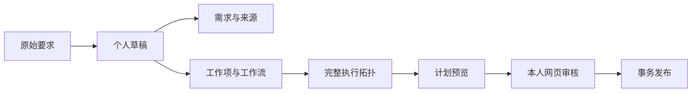

# “我的工作”个人需求草稿

Agent 用 MCP 将方案推送到 Token 账号的个人空间。本人在网页整理和发布，发布前不影响正式项目。本设计替换项目公共审核池方案，不增加审核人、转交或审批层级。

## 边界

| 对象 | 规则 |
|---|---|
| 归属 | accountId；同账号不同 Token 可接续，其他管理员也不可读 |
| 目标 | 创建时指定项目，之后固定 |
| 状态 | 草稿、已发布、已关闭；后两种只读 |
| 发布 | 本人登录会话＋目标项目经理或管理员；MCP 无发布工具 |
| 普通成员 | 可保存和分析本人草稿，不可发布 |
| 已有成果 | 需求、工作项、里程碑只读引用；允许来源关联和前置关系 |
| 执行 | 无工作项直接执行，有工作项分解执行，不增加需求层级 |
| 人员和计划 | Agent 留空人选；未知工期、未完整排期只提示 |
| 发布结果 | 默认候选，人类可明确纳入本期；不自动开工、验收或建承诺 |
| 权限失效 | 保留草稿正文，停止读取项目引用、预览和发布 |

## 内容与校验

content 保存来源条款、实体、只读引用、落实范围、依赖、模板版本及展开结果、待确认事项和私人坐标。需求含分组和标签；计划保存在实际执行实体上。

稳定 id 与来源原编号分离。原编号可重复，来源地址和原版本可空。系统生成内部修订 ID，选摘默认 complete=false。正式来源变化保留旧修订及验收事实。

保存拒绝结构错误、跨项目引用和越权操作。草稿可缺验收或暂存环路；发布前校验标题、验收、落实范围、引用、工作日日期、终态纠错原因和完整网络无环。

工作流先只读展开，再加入草稿。模板更新不覆盖人工修改，重新预览显示变化提示。计划用完整正式项目与当前草稿计算，假设草稿纳入交付以展示影响；其他草稿不参与，未知估算明确显示。实际发布范围仍按人类选择处理。

## 页面

“我的工作”默认保持执行工作，个人草稿独立查询、统计和刷新版本。未绑定人员的管理员也可使用。

| 视图 | 操作 |
|---|---|
| 列表 | 项目、状态、标题筛选；来源方式及需求／工作项数量 |
| 需求与来源 | 增删改、拆分合并、工作归属、工作流、分组标签、验收和来源范围 |
| 拓扑 | 具体工作端点、跨需求依赖、共享成果、里程碑及并行；私人坐标 |
| 计划 | 估算、日期、人类指定人选、完整网络预测及待确认项 |

删除前显示依赖和关联数量。拆分、合并和移动保留关系并提示核对。发布针对已保存且校验通过的版本。

自动保存显示状态，失败时浏览器缓存可恢复。冲突使用三方字段合并：独立修改合并，重叠字段逐项选择。发布结果未知保留原请求，先查回执，再重试同一批次。

## 接口与一致性

REST 集合为 `/api/my/requirement-drafts`：POST 创建、GET 分页和详情、PUT 保存、POST close／preview／template-preview／plan-preview／publish、GET receipts/:batchId 和只读 context。

MCP 对应 create、list、get、update、preview、template preview、plan preview、close、publish receipt 共 9 个工具。原正式工具兼容，skill 默认使用个人草稿。

创建和保存用 requestId 防重，保存用 expectedVersion 防覆盖。发布绑定草稿版本、项目版本、模板版本、业务日期、previewToken 和 batchId。一个事务写入来源、分组、需求、工作、里程碑、关联、依赖、计划、回执和状态；任一失败全部回滚。

个人保存不写正式审计和项目分析版本。正式发布沿用业务服务、权限和审计。预览使用真实账号读取权限与内存计算，不模拟管理员。

## 隔离开发

分支 `codex/personal-requirement-drafts` 基于 `dev e3ab6c5`，工作区 `D:\tools\project-manage-drafts`。试用端口 3242，前端 5177，浏览器测试 3243。独立数据库、备份、会话密钥、Cookie 和构建目录；启动前检查端口。

SKIP_CODEX_SKILL_SYNC=1 禁用构建同步。附属 worktree 默认跳过，仅显式 ALLOW_CODEX_SKILL_SYNC=1 才能启用，禁用标志优先。主工作区默认行为保持，安装测试只使用临时 CODEX_HOME。

验证覆盖账号及权限隔离、无副作用预览、拓扑调整、并发编辑、模板变化、回执、回滚、断网恢复、桌面／窄屏／HTTP，以及执行、导入和路径回归。
